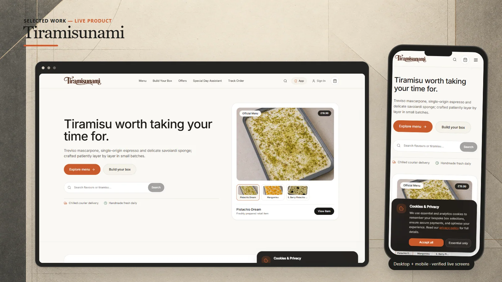
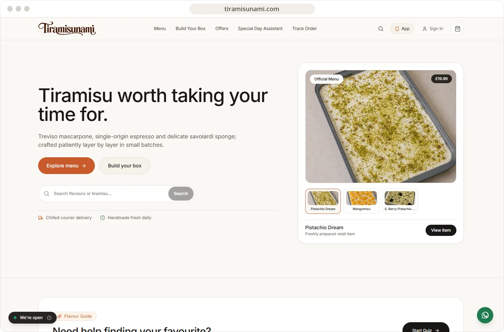
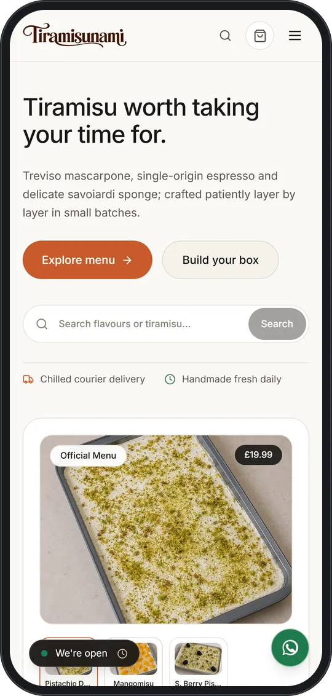

# Tiramisunami

An artisan tiramisu commerce experience built around menu discovery, custom boxes, delivery, and order follow-up.

**[Visit live website](https://tiramisunami.com)**

## Highlights

- Product-led menu and featured tiramisu collections
- Bespoke box-building and flavour discovery paths
- Chilled delivery and collection information
- Order tracking and responsive shopping flows

## Verified technology

Next.js, React, TypeScript, Tailwind CSS, Express, Socket.IO, and Capacitor are confirmed in the private source manifest. This repository contains no application code.

## Live interface

 

## About this repository

This presentation-only repository contains selected public screenshots, this README, and a small static introduction page. Application source and private configuration are not published here.

Visual content and brand assets remain the property of their respective owners. See [LICENSE](LICENSE).
