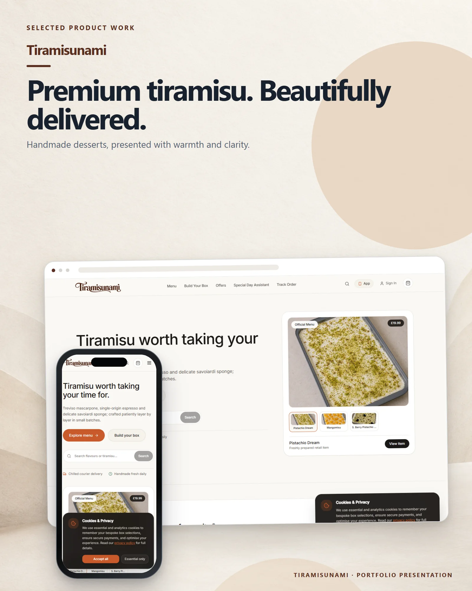

# Tiramisunami

An artisan tiramisu shop built around menu discovery, custom boxes, chilled delivery and order tracking.

**Live:** [tiramisunami.com](https://tiramisunami.com) &nbsp;·&nbsp; **More work:** [github.com/mertomeroglu](https://github.com/mertomeroglu)

### Highlights

- Product-led menu and featured tiramisu collections
- Custom box building and flavour discovery
- Chilled delivery and collection information
- Order tracking and responsive shopping flows

### Built with

Next.js · React · TypeScript · Tailwind CSS · Express · Socket.IO · Capacitor

---

Presentation-only repository: this README and two presentation images built from real product screens. Application source and private configuration are not published here. Visual content and brand assets remain the property of their respective owners — see [LICENSE](LICENSE).
