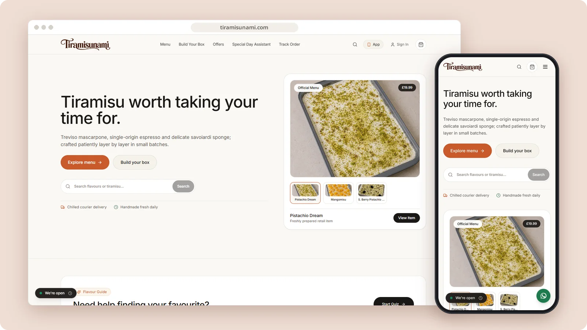

# Tiramisunami

An artisan tiramisu shop built around menu discovery, custom boxes, chilled delivery and order tracking.

**[Visit tiramisunami.com ↗︎](https://tiramisunami.com)** &nbsp;·&nbsp; [More work by Mert Ömeroğlu](https://github.com/mertomeroglu)

### Highlights

- Product-led menu and featured tiramisu collections
- Custom box building and flavour discovery
- Chilled delivery and collection information
- Order tracking and responsive shopping flows

### Built with

Next.js · React · TypeScript · Tailwind CSS · Express · Socket.IO · Capacitor

### Screens

---

Presentation-only repository. Images are real, unmodified product screens in a simple frame; application source and private configuration are not published here. Brands and visual content belong to their respective owners — see [LICENSE](LICENSE).
